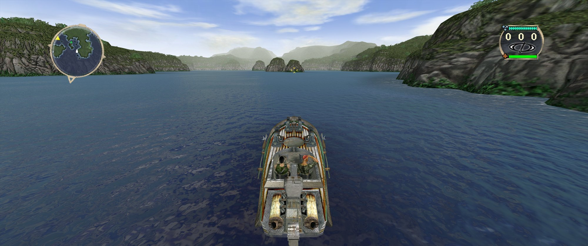
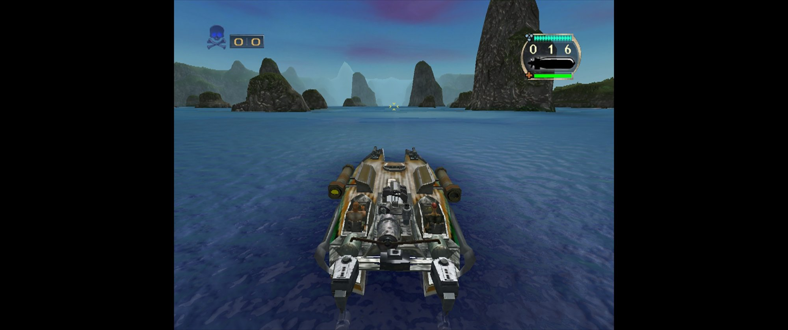
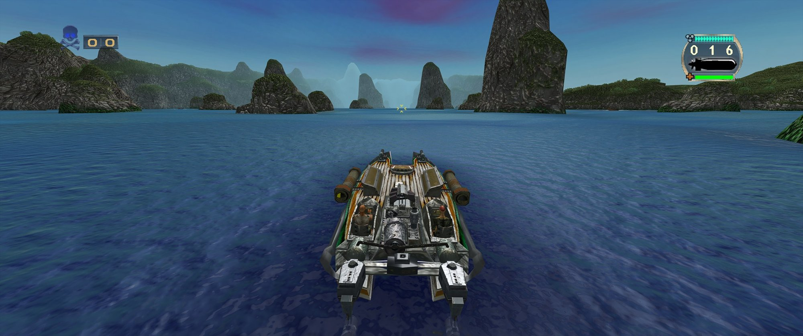
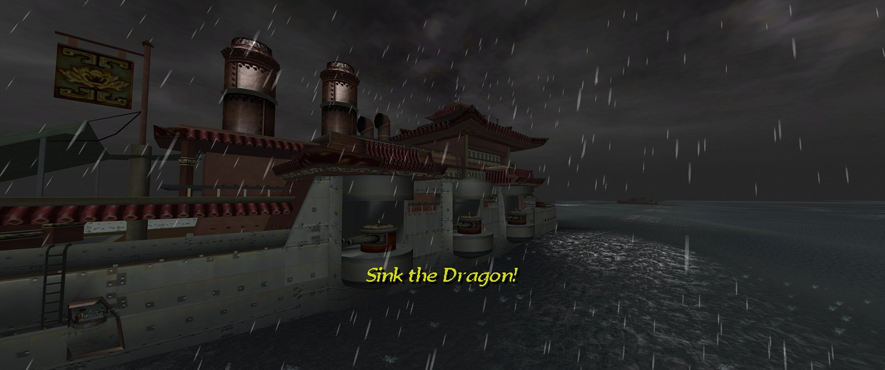
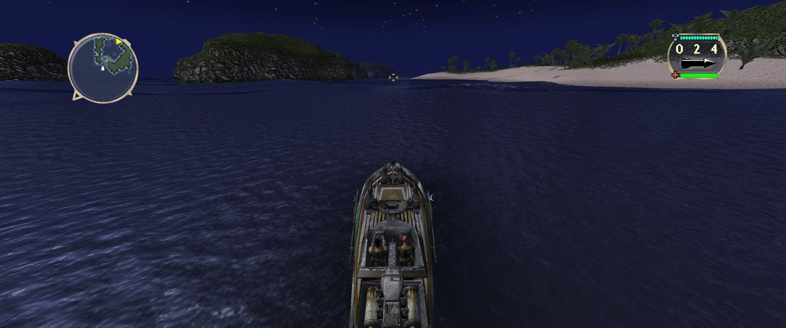
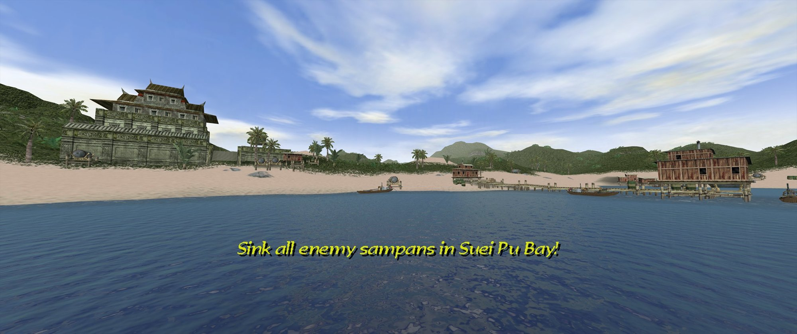
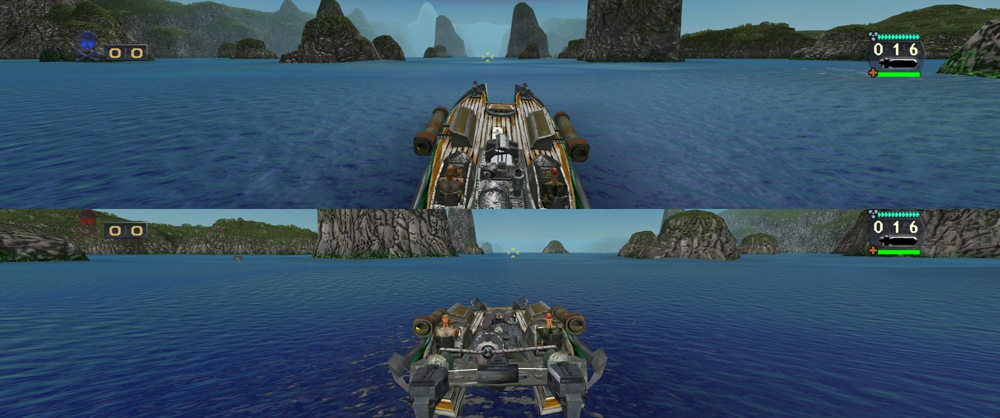
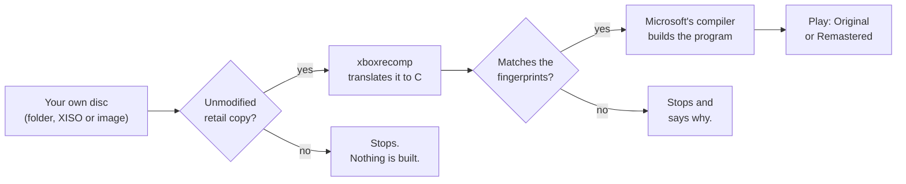

<p align="center">
  
</p>

<h3 align="center">Blood Wake (Xbox, 2001) as a native Windows game,<br>built on your own PC from your own disc.</h3>

<p align="center">
  The game's own program is translated into C and compiled for your PC: <b>static recompilation, not emulation</b>.<br>
  Play it exactly as it shipped, or remastered: ultrawide, 4K and hundreds of frames a second, with the original art and sound.<br>
  <b>Get it:</b> run the installer from <a href="https://github.com/minimalice92/bloodwake-recomp/releases">Releases</a>, point it at your copy of the disc, and it builds the game for you. Or <a href="#by-hand">build it by hand</a>.
</p>

<p align="center">
  <a href="https://github.com/minimalice92/bloodwake-recomp/releases"><b>Download the installer</b></a> ·
  <a href="#quick-start">Quick start</a> ·
  <a href="#what-you-get">Features</a> ·
  <a href="#install">Install guide</a> ·
  <a href="#troubleshooting">Troubleshooting</a> ·
  <a href="#how-it-was-made">How it was made</a> ·
  <a href="#found-on-the-disc">Found on the disc</a>
</p>

<p align="center">
  
  <br><sub>Remastered at 21:9 ultrawide, captured at 3440×1440 and scaled down. The art is the original game's: nothing redrawn or replaced.</sub>
</p>

> [!NOTE]
> **Unofficial, free and non-commercial.** You need your own Blood Wake disc: the build accepts only an unmodified retail copy. Nothing from the game is in this repository, and the project is not affiliated with Microsoft or Stormfront Studios. [How it stays clean](#built-to-be-clean) · [Good faith](#good-faith)

## Quick start
1. **You need** Windows 10 or 11 (64-bit), a graphics card with DirectX 11, and your own Blood Wake disc copied to your PC as a folder, an Xbox ISO (XISO) or a full disc image. [Details](#what-you-need)
2. **Download** `BloodWakeRecomp-Setup-<version>.exe` from [Releases](https://github.com/minimalice92/bloodwake-recomp/releases) and run it. It fetches any free build tools you're missing, from their official sites.
3. **Point it at your copy of the disc.** It checks the copy, then translates and compiles the game on your PC (about 15 minutes).
4. **Play** from the Start menu. The launcher picks the edition, Original or Remastered, and holds every setting.

Prefer the command line? [Build by hand](#by-hand). Stuck? [Troubleshooting](#troubleshooting).

<p align="center">
  
</p>

## What you get
One program, two editions, picked in the launcher. Story Mode, Battle Mode and couch split screen for 2 to 4 players work in both.

<p align="center">
  
  <br><sub><b>Original:</b> exactly as it shipped in 2001. 4:3, 30 frames a second, quirks included.</sub>
</p>
<p align="center">
  
  <br><sub><b>Remastered:</b> the same moment at 21:9. More of the world at the sides, nothing stretched, the HUD in the corners, sharper and smoother everywhere.</sub>
</p>

### Original
- **The game exactly as it shipped in 2001**, at the console's 4:3 and 30 frames a second, its quirks and bugs included. Only problems caused by the port itself are fixed.
- **The reference.** Every Remastered change is tested against it with a fixed random seed, step by step, to prove Original stays exactly as shipped.
- **The Xbox sound chip's own effects** (its echo and 3D sound programs) run as on the console, in both editions.

### Remastered
The same game, with the **original art and sound**, looking, running and sounding its best on a modern PC. Every change has its own switch.

| Area | What Remastered gives you |
|---|---|
| **Display** | Widescreen 16:9 and 21:9 ultrawide (more of the world, nothing stretched) · HUD in the corners · native resolution up to 4K · 60, 120, 144 or 240 fps, or your display's refresh rate, with the game still running at its own speed · variable refresh (G-Sync/FreeSync) · window or borderless fullscreen |
| **Graphics** | Anti-aliasing up to 8x · texture filtering up to 16x · longer detail distance · smooth gradients with no banding · sharp text and HUD · texture restoration (the original textures cleaned up close up, nothing invented) · full split-screen detail |
| **Optional extras** | Off by default, because the original didn't have them: ambient occlusion, bloom, sharpening, FXAA, **HDR**, and an **OLED care** mode |
| **Sound** | Higher-quality resampling · a slightly louder mix with a limiter · the game's own surround mix on 5.1/7.1 · lower latency |
| **Bug fixes** | **16 bugs of the original game fixed**: a story mission that could never be won, AI target rules that could never match, sounds and radio calls that never played, an endless health crate, a gap in a map edge, two textures that never shipped, and more. Original keeps every one. |

Every setting, with what it changes: [docs/SETTINGS.md](docs/SETTINGS.md). The editions in full: [docs/EDITIONS.md](docs/EDITIONS.md).

<table>
  <tr>
    <td width="50%"><br><sub>Rain, night and a battleship, at 21:9</sub></td>
    <td width="50%"><br><sub>A night mission, dark the way it should be</sub></td>
  </tr>
  <tr>
    <td width="50%"><br><sub>Daylight, a temple and a village on stilts</sub></td>
    <td width="50%"><br><sub>Two-player split screen on an ultrawide</sub></td>
  </tr>
</table>

### Frame rates
<p align="center">
  
</p>

- **The game still runs at its own speed.** It keeps its own 30 steps a second; the extra frames are drawn in between, so it plays at the same speed and looks far smoother.
- **Every frame reaches the screen.** On a 360 Hz variable-refresh display, Battle Mode shows 281 frames a second with none dropped: frames are paced evenly and wait a moment for the screen instead of being thrown away.

<details>
<summary>The numbers as a table</summary>

| Scene (Remastered defaults) | Frames per second |
|---|---|
| Battle Mode, 3440×1440 | 290 |
| Story mission 27, 3440×1440 | 262 |
| Story mission 1, 3840×2160 (4K) | 229 |
| 2-player split screen, 3440×1440 | 214 |
| Story mission 1, 3440×1440 | 205 |
| Story mission 3, 3440×1440 | 175 |
| 4-player split screen (full detail), 3440×1440 | 113 |
| The original game, any scene | 30 |

Measured on the project's test PC (GeForce RTX 4070 Ti SUPER), 28 Oct 2026.
</details>

## What you need
- **Windows 10 or 11, 64-bit**, and a graphics card with DirectX 11.
- **Your own Blood Wake disc**, copied to your PC as one of: a folder of the disc's files, an Xbox ISO (XISO), or a full disc image. Only the retail release listed in [`fingerprints/retail.json`](fingerprints/retail.json) is accepted.
- **Disk space:** several GB during the build (the game's files alone are about 2 GB).
- An Xbox-style controller (XInput), or the keyboard.

The build also needs these free tools. The installer fetches any that are missing, from their official sites only:
- **Python 3.13** (64-bit, with tkinter) and the packages pinned in [`tools/requirements.txt`](tools/requirements.txt), notably `capstone==5.0.9` and `pefile==2024.8.26`;
- **Visual Studio 2022 Build Tools** (version 17) with the C++ workload, and **CMake** 3.20 or later. Visual Studio 2026 is not supported yet;
- the **xboxrecomp** toolkit at a pinned commit, downloaded by the build script from its GitHub page and checked against a pinned hash.

## Install
### With the installer (recommended)
> **Windows may warn you:** the installer isn't code-signed, so SmartScreen can show "Windows protected your PC". Choose **More info**, then **Run anyway**. Each release lists the installer's SHA-256, so you can check you have the real file. The build takes about 15 minutes and can't be cancelled once it starts.

1. Download `BloodWakeRecomp-Setup-<version>.exe` from this repository's [Releases](https://github.com/minimalice92/bloodwake-recomp/releases) page.
2. Run it. It installs for your Windows user only and doesn't need administrator rights, except for the one step that installs Microsoft's build tools, if you don't have them.
3. Read and accept the disclaimer, confirming you own the game and made the copy from your own disc.
4. Point it at your copy of the disc (a folder, an XISO or a full image). It tells you in plain words whether the copy is recognised.
5. Pick where to install (by default `%LOCALAPPDATA%\Programs\Blood Wake Recomp`).
6. Let it build. Translating and compiling the game takes a while; a progress bar shows each step.
7. Play from the Start menu shortcut, which opens the launcher.

The uninstaller (in Windows' **Apps** settings) removes the build and its shortcuts and asks about the rest; your saves and settings are kept unless you choose otherwise.

### By hand
```
git clone https://github.com/minimalice92/bloodwake-recomp.git
cd bloodwake-recomp
python -m pip install -r tools/requirements.txt
python tools/build_from_disc.py --disc "<your disc folder or image>" --install-dir "<where to install>"
```
Then start the launcher from the install folder. Every option, step and exit code is in [docs/BUILDING.md](docs/BUILDING.md).

## Playing
The launcher has a tab per area (Edition, Display, Graphics, Audio, Fixes, Controls) and a Play button. Alt+Enter or F11 switches between a window and borderless fullscreen while you play.

Each edition keeps its own saves, under `%LOCALAPPDATA%\xboxrecomp\` (Remastered's in `editions\remastered` there); the launcher keeps its settings in `%LOCALAPPDATA%\BloodWake\settings.ini`.

## Troubleshooting
| What you see | What to do |
|---|---|
| "not a supported unmodified retail copy" (exit code 2) | Only an unmodified retail copy of the release in `fingerprints/retail.json` is accepted. A copy that was patched, trimmed or re-packed won't match. Copy your disc again. |
| A missing dependency (exit code 3) | The message names it. Install it (see What you need) or run the installer, which fetches it. |
| The translation step failed (exit code 4) | Check the Python packages are exactly the pinned versions (`python -m pip install -r tools/requirements.txt`). |
| "generated code doesn't match" (exit code 5) | Your translation came out different from ours: usually a different version of a Python package or of the toolkit. Reinstall the pinned versions and try again. |
| The build failed (exit code 6) | Make sure Visual Studio 2022 (17.x) Build Tools with the C++ workload is installed. |
| Disk space or a file error (exit code 7) | Free some space, or pick an install folder you can write to. |
| The game is slow | In the launcher, lower the rendering resolution or the frame rate cap, or turn off anti-aliasing. |
| Crackling or stuttering sound on a slow PC | Audio tab: Sound processor, Simple (it skips the sound chip's echo and 3D effects). |

If you're stuck, open an issue: say what you did, what you saw, and your Windows and graphics card. Please don't attach game files, screenshots of the game's text, or your disc image.

## How it was made
### Three days from the first plan to the first release
| Day | What happened |
|---|---|
| **Day 1** · 25 Oct 2026 | The plan and the ground rules in the morning. By night: the whole program translated (0 functions failed), the first launch, the title screen, the main menu, and a first Battle Mode match, at a few frames a second on a software renderer. |
| **Day 2** · 26 Oct | First sound. The graphics on the GPU at full speed. Story Mode, every mission booting, split screen. 948 mission runs of crash soak tests with 0 crashes. Every archive on the disc decoded, the file formats specced, and three rounds of naming the game's functions. |
| **Day 3** · 27 Oct | All 8,110 functions named. Remastered built in parallel: widescreen, high frame rate, the visual suite, the bug fixes, texture restoration, the water in native code. 24 of 28 story missions won by an autopilot. |
| **That night** · early 28 Oct | This repository, its fail-closed audit, the installer, and release v0.1.0. |

### Proof, not promises
- **Every function named: 8,110.** Agents proposed each name with evidence from the code; a second round reviewed the less certain ones; a third re-checked 6,149 names independently and confirmed 6,109 of them as they stood. Ten functions that deal with the console's security were left alone on purpose.
- **Original, proven unchanged.** Every merge is checked by playing the same seeded game on the old and new build and comparing the game's state step by step. A build made the public way, from the disc and with no names file, matches the workshop build for 3,867 of 3,867 steps, in each edition.
- **24 of 28 story missions won by an autopilot** playing the port, the final mission included, with no port problem seen in about 37 attempts. The other four need skills the autopilot doesn't have yet.
- **The water, in native code, bit for bit.** The functions that build the sea's surface every frame are re-translated at build time into plain native code doing the same operations in the same order. 2,627,309 batches compared against the game's own code: 0 differences. Four-player split screen at full detail went from 66 to 113 fps.
- **The file formats, decoded.** Models, boats and weapons, missions, effects, fonts and menus, sound and textures: specced, checked against every archive on the disc, then verified blind by separate agents.
- **57 toolkit issues found along the way.** Porting a whole game through xboxrecomp turned up 57 bugs and gaps in the toolkit: 8- and 16-bit multiplies and divides translated as 32-bit ones, point sprites, fog and polygon offset never drawn, a vertical blank of 60.00 Hz where NTSC runs at 59.94, and more. The ones that matter to the game are fixed or worked around in this project, mostly as carried copies of the toolkit's files with their diffs (`src/toolkit_patches/`) and as in-memory fixes to its translator (`tools/xbr_patches.py`), so the toolkit itself stays untouched at its pinned version. They will be offered to the xboxrecomp project with neutral repros that contain nothing from any game; none has been submitted yet.
- **16 bugs from 2001, found and fixed.** Each traced in the code before it was touched, each with its own switch, and each kept as shipped in Original.
- **A faint dark line on the distant sea, explained.** Traced to the game's own drawing: where waves fold at a grazing angle, the sky-reflection pass blends twice over the same pixels. Very likely on the original console too, so Original keeps it.
- **Data, not guesswork.** The project's rule is to work from captured data (logs, traces, frame dumps, step-by-step comparisons), never from memory or feel, and to label every finding seen, inferred or unknown.

### Made with AI
The engineering was done by Claude, Anthropic's AI model: a lead session plus more than 70 agent runs in batches (naming, file formats, stability, the fidelity checklist, the remaster, the installer), each with a written brief and a written report. The lead reviewed every batch, merged it, and re-ran the step-by-step comparison before anything counted as done. The maintainer set the direction, made the calls and played the game.

## How it works
The Xbox's processor is a PC-style x86 chip, so its program can be translated rather than emulated. The [xboxrecomp](https://github.com/sp00nznet/xboxrecomp) toolkit reads the game's program and translates every function into C. Microsoft's compiler turns that C into a normal Windows program. The toolkit's runtime provides the Xbox system calls the game makes, its memory, its sound chip and its controllers, and this port's Direct3D 11 back end turns the game's own graphics commands into work for your graphics card.



All of it happens on your PC. The only downloads are free tools from their official sites (Python, CMake, Microsoft's build tools, the toolkit), pinned to exact versions; the toolkit and the installer's downloads are checked against pinned hashes.

## Built to be clean
Fan ports live in a grey area. This one was designed from the first day to sit at its very safest end, and to be able to show it.

- **Nothing from the game is in this repository.** No game code, no generated C, no executables, and no art, sound, music, video, text or extracted files. The one exception is the handful of screenshots on this page, each listed by its fingerprint.
- **You build it yourself, from your own disc, on your own PC.** The build first checks your copy against published SHA-256 fingerprints of the unmodified retail release and refuses anything else. Then your PC translates and compiles the game with Microsoft's own build tools.
- **Fingerprints, never code.** [`fingerprints/`](fingerprints/) holds SHA-256 hashes of the retail files and of the generated C. Your build proves it matches ours without either of us ever sharing the code.
- **A fail-closed audit on every publish.** Changes reach this repository only through a scripted sync from the project's private workshop, and every file is scanned against the game itself: byte runs from the game's program and from every file on the disc (archives unpacked too), the game's text, the generated C and its telltale shapes, personal data, links, and anything to do with console security. One finding, or one input the audit can't read, and nothing is published. Each run also plants samples of game bytes, game text and generated code in memory and has to catch every one, so a broken scanner can't pass by accident. Screenshots pass only at their listed fingerprint, as plain JPEGs with no metadata.
- **The names stay private.** The file of 8,110 function names is kept out of this repository. The public build works without it and plays step for step the same.
- **Hands off the console's security.** No DRM, copy protection, licence checks, disc authentication, signing keys, save signatures or Xbox Live: none of it is touched, and none of it is needed. The toolkit reads the game's program directly and only provides the system calls the game makes. The port writes its own saves. <!-- audit:allow off-limits -->
- **A commit guard for every clone.** [`tools/git-hooks/pre-commit`](tools/git-hooks/pre-commit), switched on with one git command (see [CONTRIBUTING.md](CONTRIBUTING.md)), refuses game files, disc images, archives, executables and generated C before they can be committed.
- **Free, for good.** No sales, donations, ads or paid features.
- **Rights holders come first.** One issue titled **Takedown** and the project comes down, no questions asked. See [Contact and takedown](#contact-and-takedown).

## Found on the disc
Decoding every archive and naming every function turned up a lot that shipped on the disc but never made it into the game: cut modes, hidden boats, debug tools, early drafts. These are findings, described in our own words; **none of this content is switched on in this repository or in any release.**

<details open>
<summary><b>What was found</b></summary>

- **Six cut two-player co-op battles.** Their names, descriptions and team rules are on the disc; no menu reaches them. <!-- audit:allow expanded -->
- **A cut secret-objective system.** One mission still carries a secret objective, next to an unused results message and an unused unlock message for a joke boat.
- **A hidden level select.** A cheat flag unlocks every story mission, but no code ever sets it.
- **A developers' corner.** Debug switches survive in the code that nothing sets: free cameras, a mission clock on the HUD, switching boats, winning the mission on the spot.
- **Boats you never get to drive.** Two story-only hulls, the named story boats, a dozen enemy-only classes, and one class used nowhere.
- **Half-built systems.** Armour values that only a test boat has; AI attitudes with empty tables (only two of five attitudes ever chase or ram); a capture objective that can never succeed; a squad-tactics evaluator that is never created.
- **Leftovers.** An earlier front end with 98 images found nowhere else, five unused font sets, early drafts of the story diary, a developer test screen, an epilogue diary page nothing opens, the artists' test effects, 51 effects nothing can start, unused collision sounds, and a developer kit with a teapot in it.
- **Things that can't come back faithfully.** A 29th mission, the E3 2001 show demo, whose list entry ships but whose mission file doesn't; 41 voice lines that were written but never recorded; a second weather set for one mission whose files are missing.
</details>

### The developers' tribute (planned)
The plan for a third edition, **Expanded**, is a tribute to the team: finish what they started, honouring what is known of the sequel they designed. It is on hold while Original and Remastered are finished, and **nothing of it is in this repository or in v0.1.0**. The plan, highest impact first: <!-- audit:allow expanded -->

1. **Story Mode together.** The whole campaign with a friend in split screen, since the sequel was planned with co-op; later three or four players, for which the game's launch data already has room. <!-- audit:allow expanded -->
2. **The six cut co-op battles**, back in Battle Mode's list, plus two-player versions of the six survival modes. <!-- audit:allow expanded -->
3. **Online, starting with a network Blood Ball.** The sequel's design called for networked multiplayer, and some of the developers once planned a networked Blood Ball tribute that never happened. <!-- audit:allow expanded -->
4. **Blood Ball for everyone:** out of the cheat menu, plus team Blood Ball. The team called it their favourite feature.
5. **Living AI:** the three empty AI attitudes filled in, so battle opponents behave in more ways.
6. **Every boat in Battle Mode:** the story-only hulls, the named story boats, the enemy classes and the unused one.
7. **Secret objectives and earned unlocks:** the cut system finished, and the joke boats earned instead of typed in as codes.
8. **Armour that counts:** the cut armour system finished.
9. **A developers' corner:** the hidden level select and the harmless debug switches, in a launcher tab, off by default.
10. **A leftovers gallery:** the early front end, the diary drafts and the epilogue page, the artists' test effects in a viewer arena, and the teapot hidden somewhere for you to find.
11. **Unused sounds and effects on their events:** each wired to what it was named for, after a careful listen.
12. **Custom missions and boats:** the missions are pure data in the decoded formats, and the designers built them in a mission editor of their own; the capture objective would come with them.
13. **The squad-tactics AI** that was built but never switched on.

## Good faith
This project exists because Blood Wake is worth keeping playable, and it is meant to be a good neighbour to the people who made it and own it.

- **You must own the game.** The build accepts only an unmodified retail copy, made from your own disc, and checks it against published fingerprints (SHA-256 hashes) before it does anything else.
- **Nothing from the game is here**, apart from the few screenshots on this page: no game code, no generated C, no executables, no art, sound, music, video, text or extracted files. Your PC translates and compiles the game itself; we publish fingerprints of the generated code, never the code.
- **Strictly non-commercial.** Free, no donations, no ads.
- **No links to game images, and no help with ripping or getting around any protection.** The project doesn't need any of that and never touches console security, disc authentication or online services. <!-- audit:allow off-limits -->
- **Credit to the original team.** Blood Wake was made by Stormfront Studios and published by Microsoft Game Studios. See [CREDITS.md](CREDITS.md).
- **If Microsoft re-releases Blood Wake**, this page will point there first. Buy it.

The full disclaimer is in [LEGAL.md](LEGAL.md); please read it before you build or play.

## Credits and licence
Blood Wake is by **Stormfront Studios**, published by **Microsoft Game Studios**; all of its code, art, sound, music and writing is theirs. This port stands on [xboxrecomp](https://github.com/sp00nznet/xboxrecomp) by sp00nz and on [xemu](https://xemu.app)'s work on the Xbox's sound chip. Full credits: [CREDITS.md](CREDITS.md).

Our own code is under the **MIT** licence ([LICENSE](LICENSE)); some parts are under the GPL or LGPL ([NOTICE.md](NOTICE.md), [LICENSES/](LICENSES/)). Please read [CONTRIBUTING.md](CONTRIBUTING.md) before you open an issue.

## Contact and takedown
The maintainer is [@minimalice92](https://github.com/minimalice92) on GitHub. Questions and bug reports: open an issue.

**Rights holders:** if you are Microsoft or act for the rights holders and want this project taken down, open an issue titled **Takedown**, or contact the maintainer through GitHub. It will be taken down at once, no questions asked.
