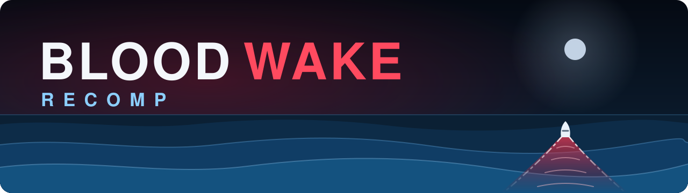

**Blood Wake (Xbox, 2001), running natively on Windows.** The game's own program is translated into C and compiled on your PC, from your own disc: static recompilation, not emulation.

**100% complete.** Every function in the game recompiled to native code with none failing, and the whole game playable in both editions: all 28 story missions, Battle Mode and split screen for up to four players. Play it exactly as it shipped, or remastered: ultrawide, 4K and up to 290 frames a second, with the original art and sound.

**[Download the installer](https://github.com/minimalice92/bloodwake-recomp/releases)** · [Features and Showcase](#features-and-showcase) · [Getting started](#getting-started) · [How it was made](#how-it-was-made) · [The roadmap](#the-roadmap) · [Staying safe](#staying-safe)

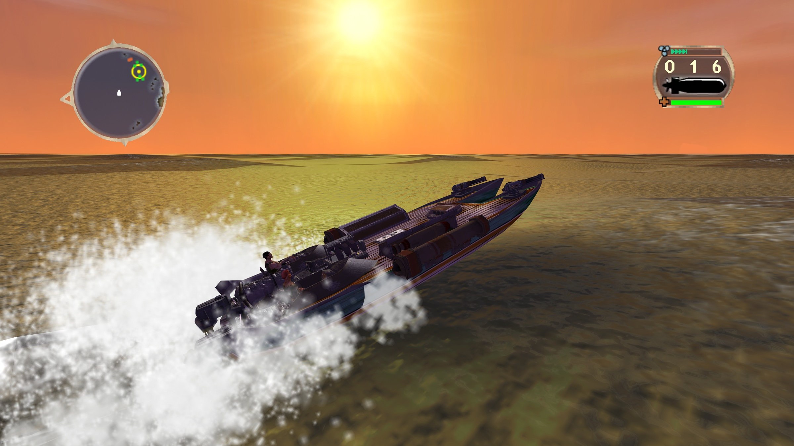
*Full speed into the sunset. Remastered at 4K with every setting maxed: the original art, nothing redrawn or replaced.*

> [!NOTE]
> Unofficial, free and non-commercial. You need your own Blood Wake disc, and nothing from the game is in this repository. See [Staying safe](#staying-safe).

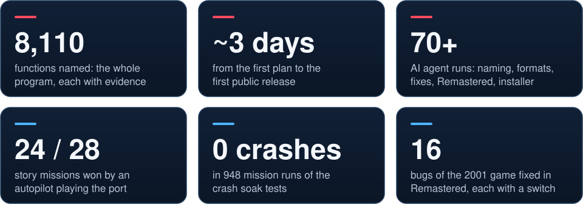

## Features and Showcase
One program, two editions, picked in the launcher.

### Original: the game as it shipped
- **Every mission and mode:** Story Mode's 28 missions, Battle Mode, and couch split screen for 2 to 4 players.
- **Exactly as shipped in 2001:** the 4:3 picture, 30 frames a second, its quirks and its bugs. Only problems the port itself would cause are fixed.
- **The console's own pace and sound:** the game runs on the console's 59.94 Hz clock, and the Xbox sound chip's own echo and 3D-sound programs run as they did on the console.
- **Its own saves**, kept apart from Remastered's.
- **Proven unchanged:** every merge is replayed against the previous build with the same random seed and compared step by step, for example 2,990 of 2,990 steps identical.

### Remastered: the same game at its best
The original art and sound, never replaced. Every change has its own switch.

**Looks**
- 16:9 and 21:9 widescreen: more of the world, nothing stretched, the HUD in the corners.
- Native resolution up to 4K, 8x anti-aliasing, 16x texture filtering, longer detail distance.
- Cleaner textures up close, no banding, sharp text. Optional HDR, ambient occlusion, bloom and an OLED care mode.

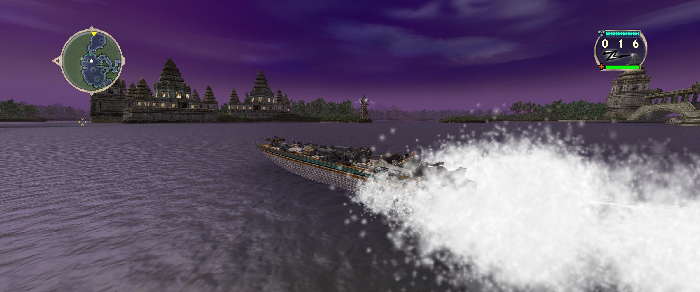
*21:9 ultrawide: the whole temple skyline, more of the world at the sides, nothing stretched.*

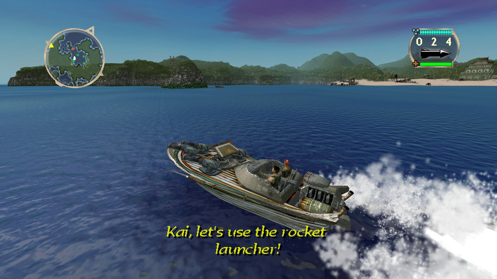
*Dawn in the islands, with the game's own subtitles drawn sharp at 4K.*

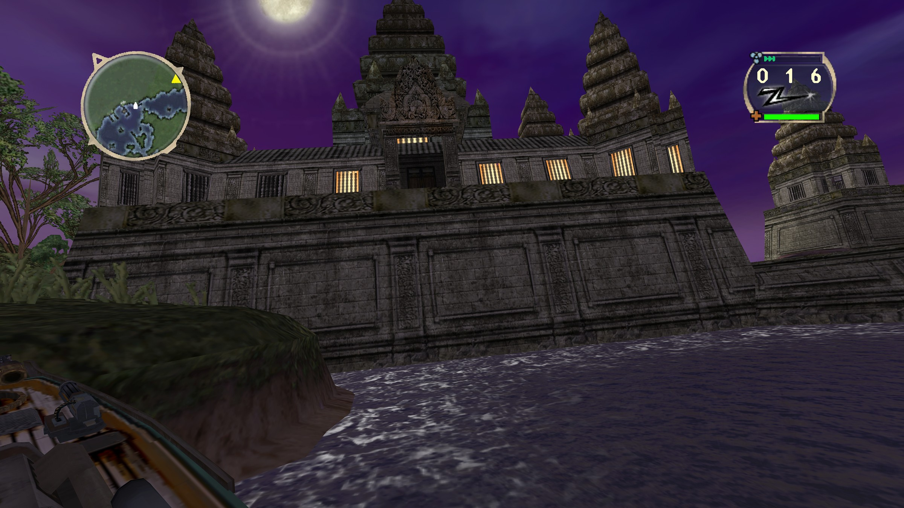
*Moonrise over the temple.*

**Runs**
- Up to 290 fps at 3440×1440 and 229 at 4K, with the game still ticking 30 times a second: the same speed, far smoother.
- Four-player split screen at full detail: 113 fps.
- Every frame shown: 281 a second in Battle Mode on a 360 Hz variable-refresh screen, none dropped.

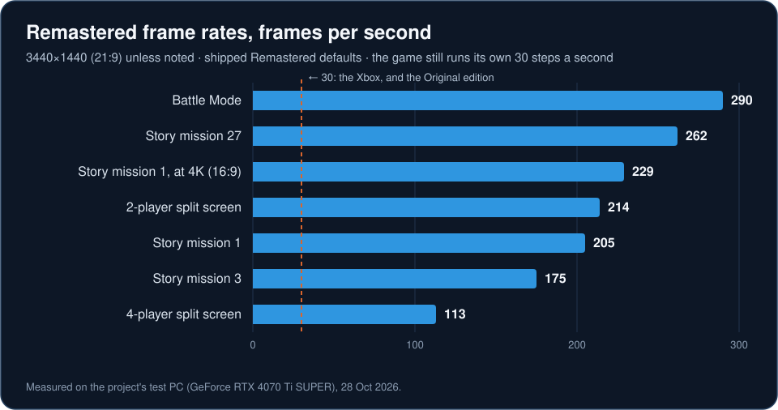

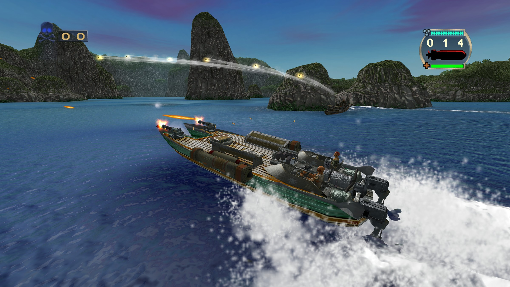
*Rockets over the Tombstones: Battle Mode in widescreen.*

**Sounds**
- Cleaner pitch changes, a louder mix with a limiter, the game's own surround mix on 5.1 and 7.1, lower latency.

**Fixes**
- 16 bugs from 2001 fixed, each switchable: a mission that could never be won, sounds and radio calls that never played, AI rules that never matched, two textures that never shipped, and more.

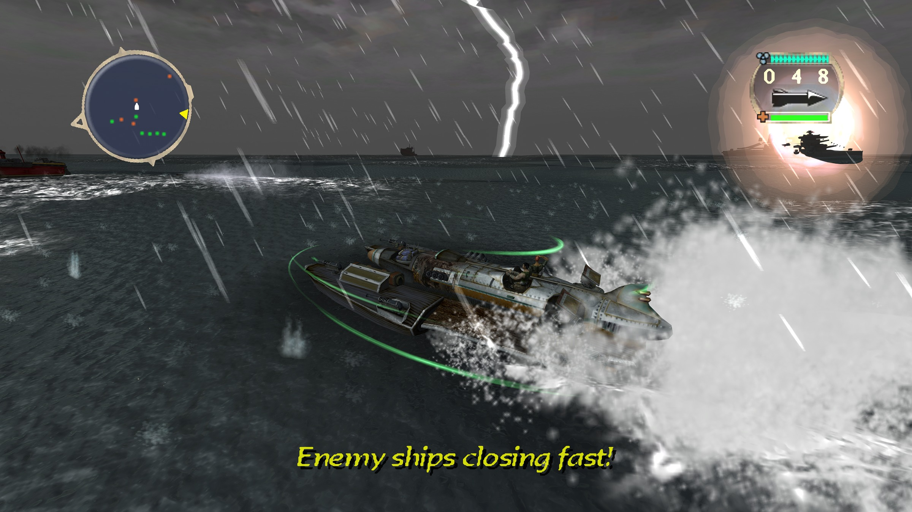
*The final storm: lightning, rain and the green arcs of the legendary shield.*

Every setting: [docs/SETTINGS.md](docs/SETTINGS.md). Both editions in full: [docs/EDITIONS.md](docs/EDITIONS.md).

## Getting started
### What you need
- **Windows 10 or 11, 64-bit**, and a graphics card with DirectX 11.
- **Your own Blood Wake disc**, copied to your PC as a folder of its files, an Xbox ISO (XISO) or a full disc image. Only the retail release in [`fingerprints/retail.json`](fingerprints/retail.json) is accepted.
- **A few GB of free space** for the build (the game's files alone are about 2 GB).
- An Xbox-style controller (XInput), or the keyboard.

The build also uses free tools, which the installer fetches if they're missing, from their official sites only: Python 3.13 with the packages pinned in [`tools/requirements.txt`](tools/requirements.txt), Visual Studio 2022 Build Tools (version 17, C++ workload; 2026 isn't supported yet), CMake 3.20 or later, and the xboxrecomp toolkit at a pinned commit, checked against a pinned hash.

### Install
> **Windows may warn you:** the installer isn't code-signed, so SmartScreen can say "Windows protected your PC". Choose **More info**, then **Run anyway**. Each release lists the installer's SHA-256, so you can check you have the real file.

1. Download `BloodWakeRecomp-Setup-<version>.exe` from [Releases](https://github.com/minimalice92/bloodwake-recomp/releases) and run it. It installs for your Windows user only; only the step that installs Microsoft's build tools, if needed, asks for administrator rights.
2. Accept the disclaimer, confirming you own the game and copied it from your own disc.
3. Point it at your copy of the disc. It tells you in plain words whether the copy is recognised.
4. Pick the install folder (by default `%LOCALAPPDATA%\Programs\Blood Wake Recomp`) and the shortcuts.
5. Let it build: translating and compiling the game takes about 15 minutes, with a progress bar, and can't be cancelled once it starts.
6. Play from the Start menu or the desktop shortcut.

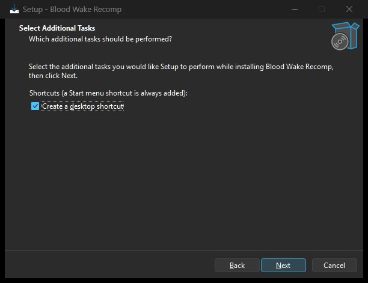
*The installer: a Start menu shortcut always, a desktop one if you like.*

To uninstall, use Windows' **Apps** settings: it removes the build and its shortcuts, and keeps your saves and settings unless you choose otherwise.

**Or build by hand:**
```
git clone https://github.com/minimalice92/bloodwake-recomp.git
cd bloodwake-recomp
python -m pip install -r tools/requirements.txt
python tools/build_from_disc.py --disc "<your disc folder or image>" --install-dir "<where to install>"
```
Then start the launcher from the install folder. Every option, step and exit code: [docs/BUILDING.md](docs/BUILDING.md).

### Playing
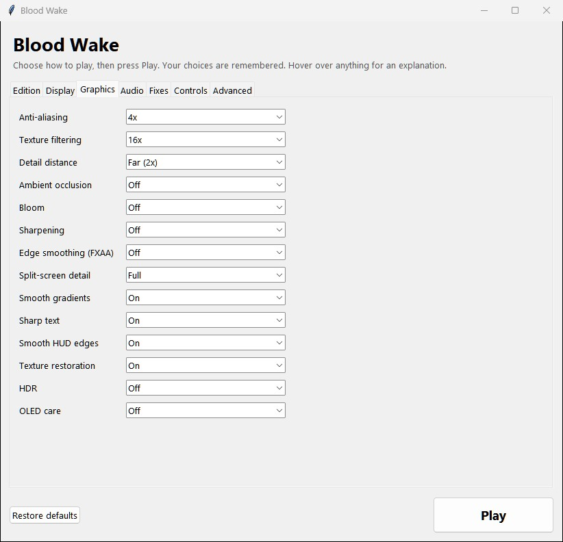
*The launcher: pick an edition and your settings, then press Play.*

- The launcher has a tab each for Edition, Display, Graphics, Audio, Fixes and Controls. Hover over anything for an explanation.
- Alt+Enter or F11 switches between a window and borderless fullscreen while you play.
- Each edition keeps its own saves, under `%LOCALAPPDATA%\xboxrecomp\` (Remastered's in `editions\remastered`). The first time you play Remastered, it starts with a copy of your Original saves. Settings live in `%LOCALAPPDATA%\BloodWake\settings.ini`.

### Troubleshooting
- **"not a supported unmodified retail copy" (exit code 2):** only an unmodified copy of the release in `fingerprints/retail.json` is accepted. A patched, trimmed or re-packed copy won't match: copy your disc again.
- **A missing dependency (exit code 3):** the message names it. Install it, or run the installer, which fetches it.
- **The translation failed (exit code 4):** check the Python packages are exactly the pinned versions (`python -m pip install -r tools/requirements.txt`).
- **"generated code doesn't match" (exit code 5):** usually a different version of a Python package or of the toolkit. Reinstall the pinned versions and try again.
- **The build failed (exit code 6):** make sure Visual Studio 2022 (17.x) Build Tools with the C++ workload is installed.
- **Disk space or a file error (exit code 7):** free some space, or pick an install folder you can write to.
- **The game is slow:** in the launcher, lower the rendering resolution or the frame rate cap, or turn off anti-aliasing.
- **Crackling sound on a slow PC:** Audio tab, Sound processor: Simple (it skips the sound chip's echo and 3D effects).

Still stuck? Open an issue: say what you did, what you saw, and your Windows version and graphics card. Please don't attach game files, screenshots of the game's text, or your disc image.

## How it was made
### How it works
The Xbox runs a PC-style x86 processor, so its program can be translated instead of emulated. The [xboxrecomp](https://github.com/sp00nznet/xboxrecomp) toolkit turns every function of the game into C, and Microsoft's compiler builds that into a Windows program. The toolkit's runtime stands in for the Xbox's system, memory, sound chip and controllers, and this port's Direct3D 11 back end turns the game's own graphics commands into work for your graphics card.

### Made with AI
The engineering was done by Claude, Anthropic's AI model: a lead session plus **70+ AI agents** working in batches (naming, file formats, stability, fidelity checks, the remaster, the installer). Each batch had a written brief and a written report, and the lead reviewed and re-verified it before merging. The maintainer set the direction, made the calls and played the game.

- **25 Oct 2026:** the plan in the morning; by night the whole program translated, booting to the menus and playing Battle Mode.
- **26 Oct:** sound, GPU graphics at full speed, every mission booting, split screen, 948 soak runs without a crash.
- **27 Oct:** all 8,110 functions named, and Remastered built.
- **Early 28 Oct:** the installer, this repository and release v0.1.0.

### Proof, not promises
- **Original stays exactly as shipped.** Every merge is replayed against the previous build with the same random seed and compared step by step. A build made the public way, from the disc and without the private names file, matches the workshop build for 3,867 of 3,867 steps in each edition.
- **The translation is deterministic.** Six runs gave six identical sets of generated C, and every player's build is checked against the published fingerprints of it.
- **The water, rewritten bit for bit.** The functions that build the sea's surface each frame are re-translated at build time into plain native code doing the same operations in the same order. 2,627,309 batches compared with the game's own code: 0 differences. Four-player split screen went from 66 to 113 fps.
- **Stable.** 0 crashes in 948 mission runs of soak tests; a later soak of every mission, both battles and Blood Ball: 0 crashes, 0 freezes.
- **Played through.** An autopilot won 24 of the 28 story missions, the final one included, with no port problem in about 37 attempts. The other four need skills the autopilot doesn't have yet.
- **57 toolkit issues found and fixed here.** From 8- and 16-bit multiplies translated as 32-bit ones, to point sprites, fog and polygon offset never drawn, to a 60.00 Hz vertical blank where NTSC runs at 59.94. The fixes are carried in this project (`src/toolkit_patches/`, `tools/xbr_patches.py`), with the toolkit itself untouched at its pinned version. They will be offered to xboxrecomp with neutral repros containing nothing from any game; none has been submitted yet.
- **Every function named: 8,110.** Each name proposed with evidence from the code, and 6,149 re-checked independently (6,109 confirmed as they stood). Ten functions that deal with the console's security were left alone on purpose.
- **The file formats, decoded.** Models, boats and weapons, missions, effects, fonts, menus, sound and textures: specced, checked against every archive on the disc, then verified blind.
- **Bugs explained before they're fixed.** Each of the 16 fixes was traced in the code first. The faint dark line on the distant sea was traced too: the game's own drawing, where folded waves get the sky reflection blended twice. It's very likely on the console as well, so Original keeps it.
- **Data, not guesswork.** The project works from captured data (logs, traces, frame dumps, step-by-step comparisons), never from memory or feel, and labels every finding seen, inferred or unknown.

## The Roadmap
### The Expanded Edition<!-- audit:allow expanded -->
Expanded is the planned third edition: a tribute to the developers that finishes what they started. It builds on what turned up when every archive was decoded and every function named. **None of it is in this repository or in any release yet.** <!-- audit:allow expanded -->

The plan, best value for the effort first (lift in agent time: S hours, M about a day, L days, XL weeks):

1. **Co-op battles** (S–M). *Found:* six two-player co-op battles were cut; their names, descriptions and team rules are on the disc, and the game's mode list is plain data. *Plan:* put the six back in Battle Mode with their teams and AI opponents. <!-- audit:allow expanded -->
2. **Co-op Story Mode** (M). *Found:* the launch data already holds up to four players, and split screen follows the player count. *Plan:* player 2 joins at boat select, two HUDs, respawns near your teammate, and a mission is lost only when both of you are down. Three or four players later. <!-- audit:allow expanded -->
3. **Co-op survival** (S–M). *Found:* a two-player survival game ends the moment player 1 sinks. *Plan:* an everyone's-down rule, team results, and two-player versions of the six survival modes. <!-- audit:allow expanded -->
4. **Blood Ball for everyone** (S–M). *Found:* the mode the team called their favourite sits behind a cheat. *Plan:* a normal menu entry plus team Blood Ball, two against two or both of you against the AI.
5. **Every boat in Battle Mode** (S–M). *Found:* two story-only hulls, the named story boats (they already play when a battle names them), a dozen enemy-only classes and one class used nowhere. *Plan:* boat-select slots, a HUD icon where one is missing, and a balance check for each.
6. **A developers' corner** (S). *Found:* a hidden level select that no code ever switches on, and debug switches nothing sets: free cameras, a mission clock on the HUD, switching boats. *Plan:* the harmless ones in a launcher tab, off by default.
7. **Secret objectives and earned unlocks** (S–M). *Found:* a cut secret-objective type, one mission still carrying one, and unused messages for unlocking a joke boat that today is only a cheat. *Plan:* finish the system, so the cheat boats can be earned.
8. **A leftovers gallery** (S–M). *Found:* an earlier front end that is never loaded (98 images found nowhere else), five unused font sets, early diary drafts, an epilogue page nothing opens, the artists' test effects, and a developer kit with a teapot in it. *Plan:* a gallery, a viewer arena for the effects, and the teapot hidden for you to find.
9. **Living AI** (M–L). *Found:* three of the AI's five attitudes have empty tables, so only two ever chase, ram or grab power-ups. *Plan:* fill them in for more varied opponents.
10. **Armour that counts** (M). *Found:* a cut armour system; only a test boat has armour values. *Plan:* finish it, with a balance pass.
11. **Unused sounds and effects** (M). *Found:* 51 effects nothing can start, plus unused collision and scrape sounds. *Plan:* wire each to the event it was named for, after a careful listen.
12. **Custom missions and boats** (L). *Found:* the missions are pure data in the decoded formats, built in the designers' own mission editor, and a capture objective that can never succeed. *Plan:* load your own missions and boats, with the capture objective finished.
13. **Squad tactics** (L). *Found:* a squad-matchup evaluator for the AI that is compiled in but never switched on. *Plan:* switch it on and tune it.
14. **Online, starting with a network Blood Ball** (XL). *Found:* the sequel's design called for networked multiplayer, and some of the developers once planned a network Blood Ball. *Plan:* delay-based lockstep, which a research pass for this project judged feasible. <!-- audit:allow expanded -->

Some things can't come back faithfully: a 29th mission (the E3 2001 show demo) whose list entry ships but whose mission file doesn't, 41 voice lines that were written but never recorded, and a second weather set for one mission whose files are missing.

## Staying safe
Fan ports live in a grey area. This one is built to be clean, to sit at the very safest end of it, and to be able to show it.

- **You must own the game.** The build accepts only an unmodified retail copy made from your own disc, and checks it against published SHA-256 fingerprints before it does anything else.
- **You build it yourself, on your own PC.** Your PC translates and compiles the game with Microsoft's own build tools; no game code or program is ever downloaded.
- **Nothing from the game is in this repository.** No game code, generated C or executables, and no art, sound, music, video, text or extracted files. The one exception is the handful of game screenshots on this page, each listed by its fingerprint.
- **Fingerprints, never code.** [`fingerprints/`](fingerprints/) holds SHA-256 hashes of the retail files and of the generated C, so your build proves it matches ours without the code ever being shared.
- **A fail-closed audit on every publish.** Every change arrives through a scripted sync that scans each file against the game itself (its program, every file on the disc, its text) and for generated C, personal data, outside links and anything to do with console security. One finding, or one input it can't read, and nothing is published. Each run plants samples of game bytes, text and code and must catch them all, and images pass only at their listed fingerprint, with no metadata.
- **The names stay private.** The file of 8,110 function names is kept out; the public build works without it and plays step for step the same.
- **A commit guard for every clone.** [`tools/git-hooks/pre-commit`](tools/git-hooks/pre-commit), switched on with one git command (see [CONTRIBUTING.md](CONTRIBUTING.md)), refuses game files, disc images, archives, executables and generated C.
- **Hands off the console's security.** No DRM, copy protection, licence checks, disc authentication, signing keys, save signatures or Xbox Live: none of it is touched, and none of it is needed. The toolkit reads the game's program directly and only provides the system calls the game makes, and the port writes its own saves. <!-- audit:allow off-limits -->
- **No help getting the game any other way.** No links to game images, and no help with ripping a disc or getting around any protection. <!-- audit:allow off-limits -->
- **Free, for good.** No sales, donations, ads or paid features.
- **Credit where it's due.** Blood Wake was made by Stormfront Studios and published by Microsoft Game Studios ([CREDITS.md](CREDITS.md)). If Microsoft ever re-releases it, this page will point there first. Buy it.

The full disclaimer is in [LEGAL.md](LEGAL.md); please read it before you build or play.

### Contact and takedown
The maintainer is [@minimalice92](https://github.com/minimalice92) on GitHub. Questions and bug reports: open an issue.

**Rights holders:** if you are Microsoft or act for the rights holders and want this project taken down, open an issue titled **Takedown**, or contact the maintainer through GitHub. It will be taken down at once, no questions asked.

## Credits and licence
Blood Wake is by **Stormfront Studios**, published by **Microsoft Game Studios**; all of its code, art, sound, music and writing is theirs. This port stands on [xboxrecomp](https://github.com/sp00nznet/xboxrecomp) by sp00nz and on [xemu](https://xemu.app)'s work on the Xbox's sound chip. Full credits: [CREDITS.md](CREDITS.md).

Our own code is under the **MIT** licence ([LICENSE](LICENSE)); some parts are under the GPL or LGPL ([NOTICE.md](NOTICE.md), [LICENSES/](LICENSES/)). Please read [CONTRIBUTING.md](CONTRIBUTING.md) before you open an issue.
